# Switchblade Admin Guide: Products, Coupons and Campaigns

How to add a product in the admin, then create a campaign and a coupon for it.

- Admin URL: `/admin` on the site (locally `http://localhost:3002/admin` or whichever port `pnpm dev` prints)
- Screenshots are from the local admin, using the existing **2JZ Archival T-Shirt** and the **[DEMO]** campaign and coupons.

> **Where customers use coupons:** on the bag page, in the **Coupon code** box under the order summary. Razorpay's own coupon box isn't used (it needs Magic Checkout, which is off). The code is checked against everything set in Parts 5 and 6, and Razorpay charges the discounted amount.

## Contents

1. [Log in and find your way around](#part-1-log-in-and-find-your-way-around)
2. [Upload product images](#part-2-upload-product-images)
3. [Set up collections and categories](#part-3-set-up-collections-and-categories)
4. [Create the product](#part-4-create-the-product)
5. [Create a campaign](#part-5-create-a-campaign)
6. [Create a coupon for the product](#part-6-create-a-coupon-for-the-product)
7. [Check your work](#part-7-check-your-work)
8. [Troubleshooting](#troubleshooting)

---

## Part 1. Log in and find your way around

1. Open `/admin` and sign in with your staff email and password. Enter the two-factor code if asked.
2. The dashboard shows recent orders and totals. **Create product** (top right) is a shortcut to Part 4.

The sidebar groups everything you need:

| Section        | Used in this guide                                                    |
| -------------- | --------------------------------------------------------------------- |
| **Products**   | Products, Categories, Collections, Options (colours and sizes), Media |
| **Promotions** | Promotions (coupons), Campaigns                                       |

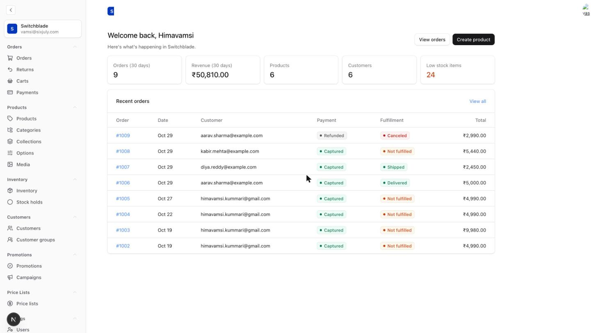

---

## Part 2. Upload product images

You can upload images here first, or straight from the product form in Part 4 (**Create New** under Thumbnail or Media). Uploading first is tidier when you have many.

1. Sidebar → **Products → Media**, then **Create New**.
2. Click **Select a file** (or drag a file in). Only images are accepted.
3. Fill **Alt** (required). Describe the picture, for example "Red 2JZ T-shirt, front".
4. Click **Save**.
5. Repeat for each photo: front, side, back, and each colour.

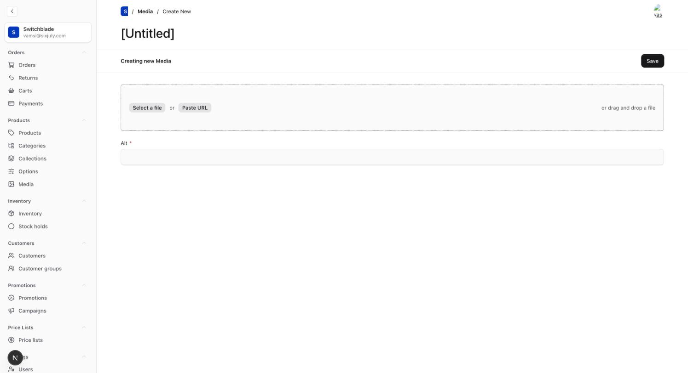

> Name your files clearly (`red-front.png`, `blue-back.png`). The product form lists them by file name.

---

## Part 3. Set up collections and categories

Skip this if the collection and category you want already exist.

1. Sidebar → **Products → Collections** (for example "New Arrivals"), then **Create New**, fill **Title**, and **Save**.
2. Do the same under **Categories** if you use them for shop navigation.
3. Colours and sizes live under **Products → Options**. Add a new colour or size there before using it on a product.

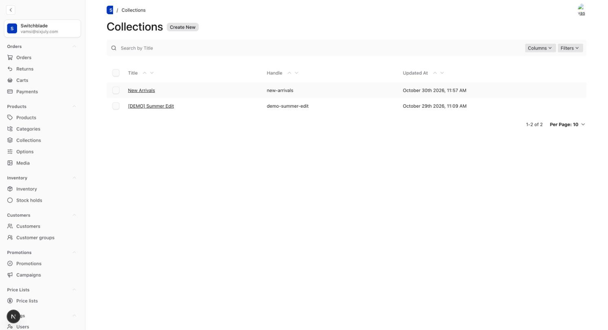

---

## Part 4. Create the product

Sidebar → **Products → Products**, then **Create New**.

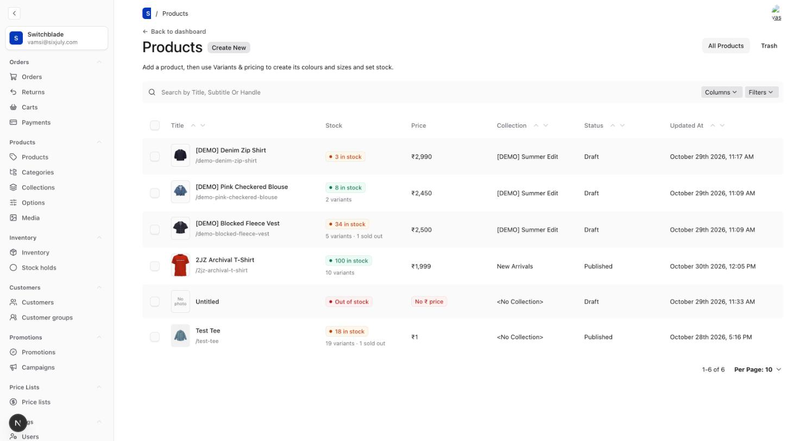

The form has five tabs (**General, Variants & pricing, Organize, Storefront, Attributes**) and a right-hand sidebar. The buttons at the top are:

- **Save Draft**: saves without showing the product in the shop.
- **Publish changes**: saves and makes it live.

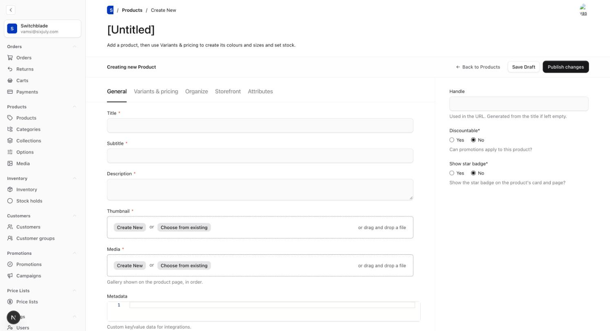

### Step 4.1 General tab

| Field              | What to enter                                                                |
| ------------------ | ---------------------------------------------------------------------------- |
| **Title** \*       | Product name, for example "2JZ Archival T-Shirt"                             |
| **Subtitle** \*    | Short line under the name, for example "Capsule 01 - Limited Release"        |
| **Description** \* | Main description                                                             |
| **Thumbnail** \*   | **Choose from existing** and pick one image. It's used on product cards.     |
| **Media** \*       | The product page gallery. Add several images; drag the ⋮⋮ handle to reorder. |

\* = required.

### Step 4.2 Sidebar (right side)

| Field               | What to do                                                                                   |
| ------------------- | -------------------------------------------------------------------------------------------- |
| **Handle**          | The URL: `/products/<handle>`. Leave it empty and it's made from the title.                  |
| **Discountable**    | **Set to Yes** if coupons should ever apply to this product. A new product starts on **No**. |
| **Show star badge** | Yes shows the star badge on the card and product page.                                       |

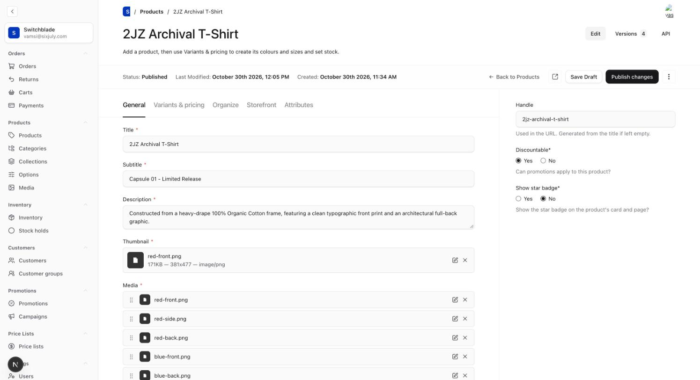

**Save Draft now.** You need to save once before you can add variants in the next step.

### Step 4.3 Variants & pricing tab

**a) Turn on variants** (only if the product comes in colours or sizes)

1. Tick **Enable variants**.
2. Under **Variant Types**, add **Color** and **Size**.

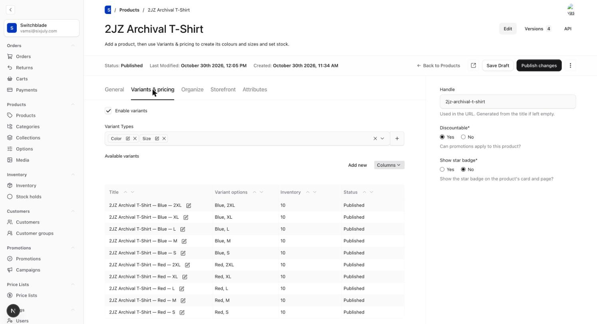

**b) Set the price.** This is required, because the shop hides products without one.

1. Scroll down, tick **Enable INR price**, and enter the price in rupees, for example `1999.00`.
2. Leave USD, EUR and GBP off.

The shop and checkout use this product price. The per-variant price in the table below is not used by the storefront.

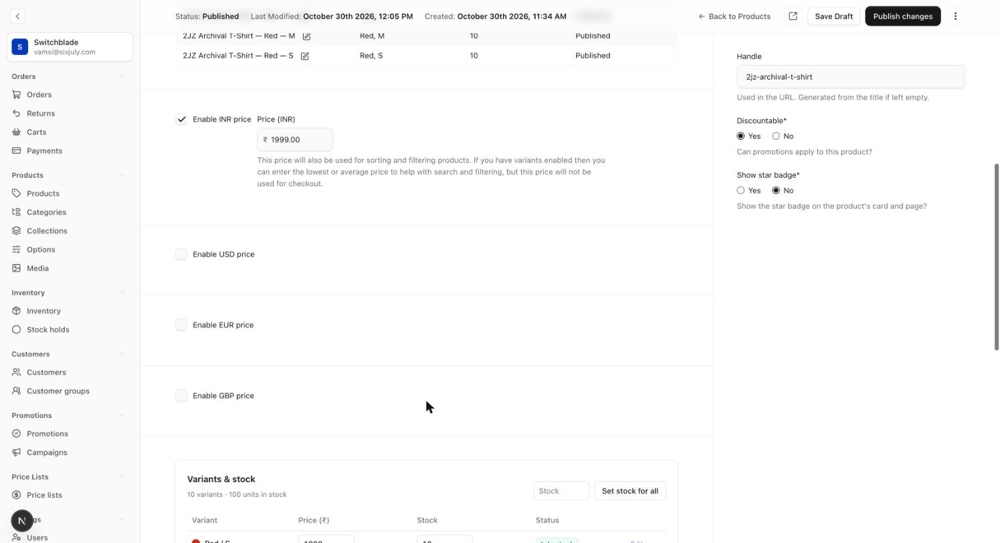

**c) Create variants and stock** (in the **Variants & stock** panel)

1. Under **Add variants**, tick the colours and sizes you sell.
2. Enter **Price (₹)** and **Stock each**.
3. Click **Create N variants**. It creates every missing colour × size combination at once.
4. Edit any variant's stock in the table above. To give every variant the same stock, type it in **Stock** and click **Set stock for all**.
5. Status shows **In stock**, low stock (5 or fewer), or sold out.

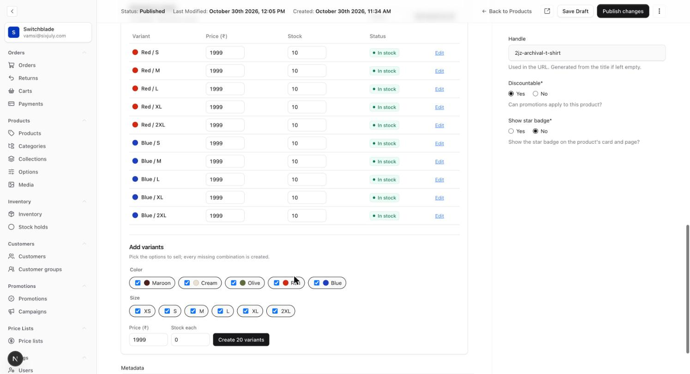

If the product has no variants, leave **Enable variants** off and set the stock in the **Inventory** field instead.

### Step 4.4 Organize tab

| Field            | What to enter                              |
| ---------------- | ------------------------------------------ |
| Type             | Optional product type                      |
| **Collection**   | For example "New Arrivals" (from Part 3)   |
| Categories       | Shop categories                            |
| Tags             | Optional labels                            |
| Sales channels   | Leave empty to sell in the default channel |
| Shipping profile | Leave empty unless told otherwise          |

The **+** button next to each field creates a new one without leaving the page.

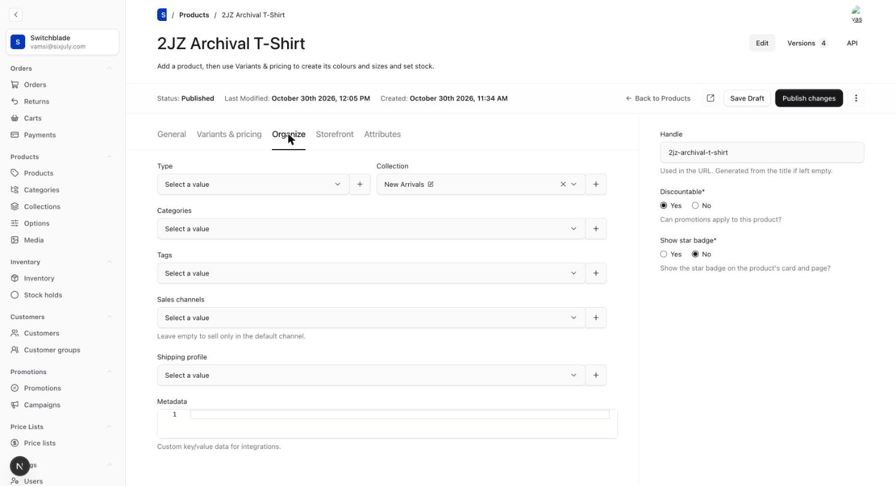

### Step 4.5 Storefront tab

| Field                  | What it does                                                                                                                                                                                             |
| ---------------------- | -------------------------------------------------------------------------------------------------------------------------------------------------------------------------------------------------------- |
| **Details**            | Text in the product page's _Details_ accordion (fabric, fit and so on)                                                                                                                                   |
| **Shipping & returns** | Text in the _Shipping & Returns_ accordion                                                                                                                                                               |
| **Colour photos**      | Optional. Per colour: pick the **Colour**, then its **Photos**. The first photo becomes the colour tile, and choosing that colour shows its photos in the gallery. Click **Add Colour** for each colour. |
| Card image frame       | Optional. Where the photo sits inside the listing card, in %. Leave empty for a full-bleed photo.                                                                                                        |

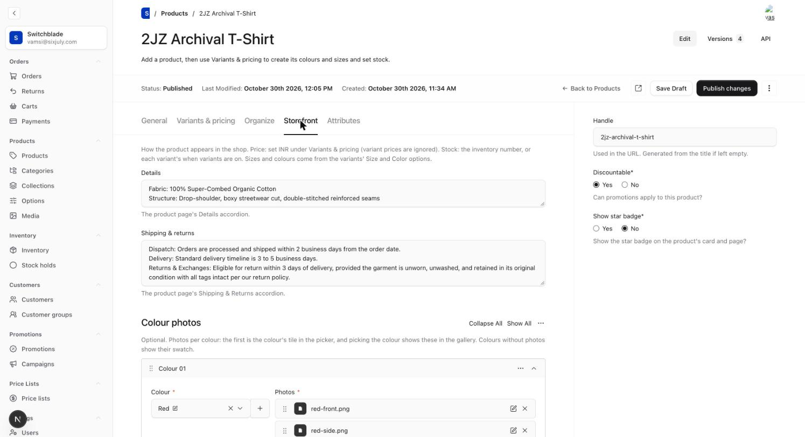

### Step 4.6 Attributes tab (optional)

Weight (g), length, width, height (cm), material, country of origin, HS code and MID code. Fill weight and dimensions if they're used for shipping quotes.

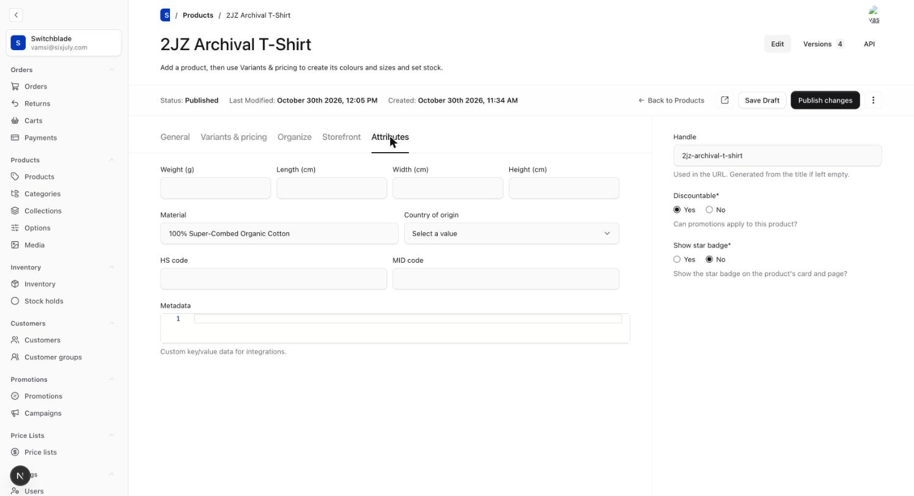

### Step 4.7 Publish

1. Click the **Preview** icon (square with an arrow, next to Save Draft) to see the product page.
2. Click **Publish changes**. The status at the top changes to **Published**.
3. Check the product on the shop at `/products/<handle>`.

---

## Part 5. Create a campaign

A campaign groups coupons for a sale, for example "Diwali Sale", and can cap the total spend or number of uses. It's optional; a coupon works without one.

1. Sidebar → **Promotions → Campaigns**, then **Create New**.
2. Fill in:

| Field                 | What to enter                                              |
| --------------------- | ---------------------------------------------------------- |
| **Name** \*           | For example "Diwali Sale"                                  |
| **Identifier** \*     | Unique, lowercase, for example `diwali-sale`               |
| Description           | Internal note                                              |
| Start date / End date | When the campaign runs                                     |
| Budget → Type         | **Total spend** or **Number of uses**                      |
| Budget → Currency     | INR (₹). Only shown for Total spend.                       |
| Budget → Limit        | The cap. Total spend is in **paise**: `5000000` = ₹50,000. |
| Budget → Used         | Read-only; filled in automatically                         |

3. Click **Save**.

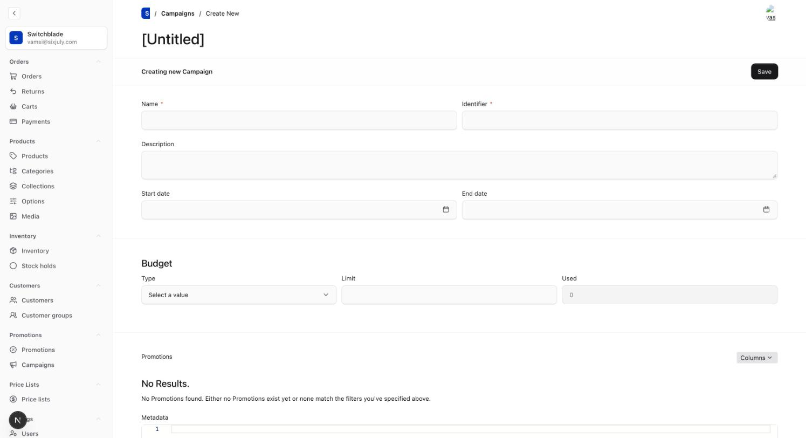

After you link coupons to it (Part 6), they're listed at the bottom under **Promotions**:

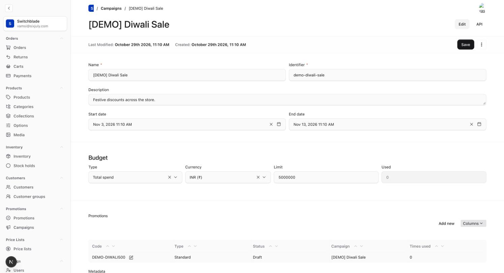

---

## Part 6. Create a coupon for the product

Sidebar → **Promotions → Promotions**, then **Create New**.

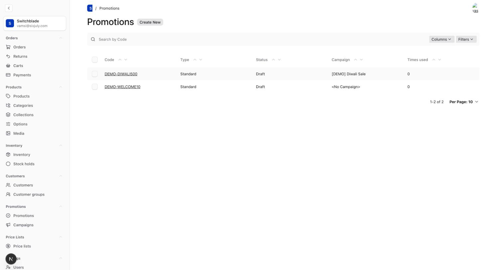

### Step 6.1 Code and type

| Field       | What to enter                                                                             |
| ----------- | ----------------------------------------------------------------------------------------- |
| **Code** \* | What the customer types, for example `SAVE10`. It's saved in capitals and must be unique. |
| **Type** \* | **Standard** for a normal discount, or **Buy X get Y**                                    |

### Step 6.2 Discount

| Field             | What to enter                                                                                        |
| ----------------- | ---------------------------------------------------------------------------------------------------- |
| **Type** \*       | **Percentage** or **Fixed amount**                                                                   |
| **Value** \*      | Percentage: `10` = 10% off. Fixed amount: in **paise**, so `50000` = ₹500 off.                       |
| Currency          | Only for Fixed amount: INR                                                                           |
| **Applies to** \* | **Order total**: whole order. **Specific items**: chosen products only. **Shipping**: shipping cost. |

This is a whole-order coupon (Applies to = Order total):

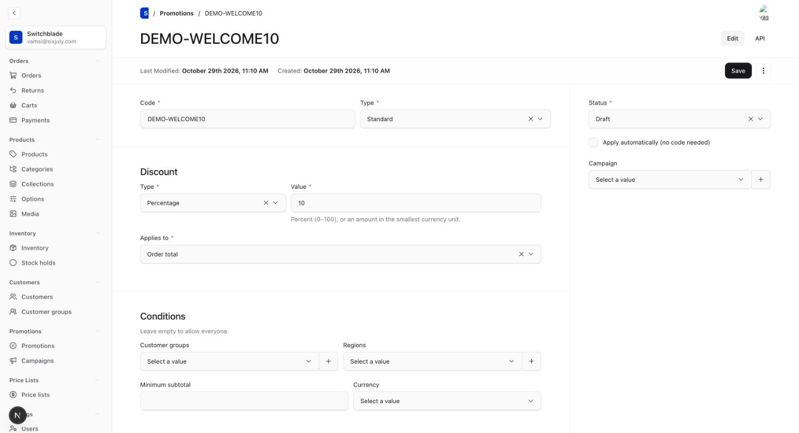

### Step 6.3 Link the coupon to your product

1. Set **Applies to** to **Specific items**. More fields appear.
2. **Products**: pick your product, for example "2JZ Archival T-Shirt". You can pick several.
   - Or use **Categories** or **Collections** to cover a whole group.
3. **Allocation**: **Spread across items** (the discount is shared across matching items) or **Each item** (applied to each one).
4. **Max discounted quantity**: optional limit on how many units get the discount.
5. In the sidebar:
   - **Status**: **Active** to use it. **Draft** = not ready; **Inactive** = switched off.
   - **Campaign**: pick the campaign from Part 5.
   - **Apply automatically (no code needed)**: tick for a discount that applies without typing a code.

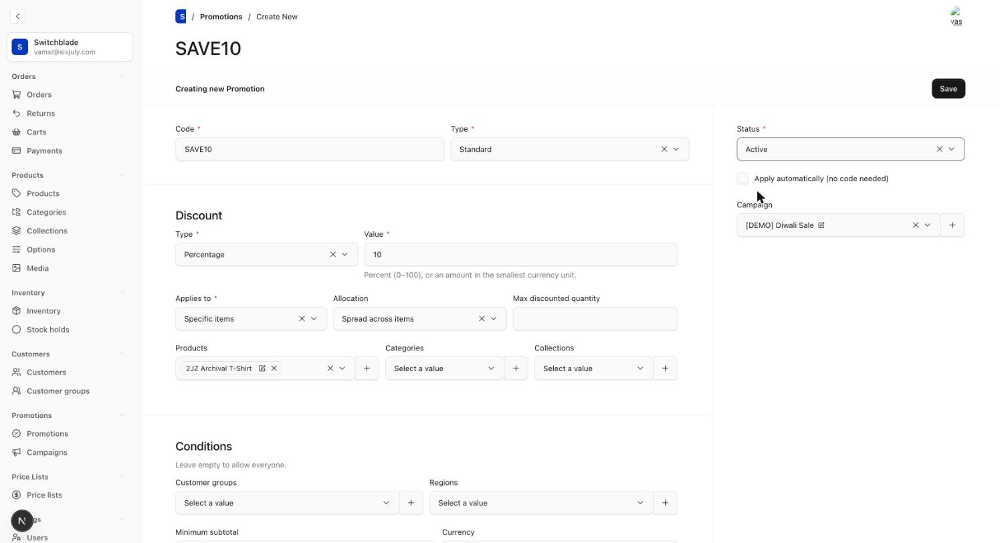

> The product must have **Discountable = Yes** (Step 4.2), or the coupon won't apply to it.

**Buy X get Y:** choose this Type in Step 6.1. A **Buy X** group appears: set the **Quantity** and **Products** the customer must buy. The Discount section then describes what they get.

### Step 6.4 Conditions (optional)

Leave all of these empty to let everyone use the coupon.

| Field                       | Use                                                               |
| --------------------------- | ----------------------------------------------------------------- |
| Customer groups             | Only these groups can use it (for example VIP)                    |
| Regions                     | Only these regions                                                |
| Minimum subtotal + Currency | The cart must reach this amount, in **paise** (`200000` = ₹2,000) |

### Step 6.5 Dates and limits

| Field         | Use                                 |
| ------------- | ----------------------------------- |
| Starts / Ends | When the code works                 |
| Usage limit   | Total number of redemptions allowed |
| Times used    | Read-only counter                   |

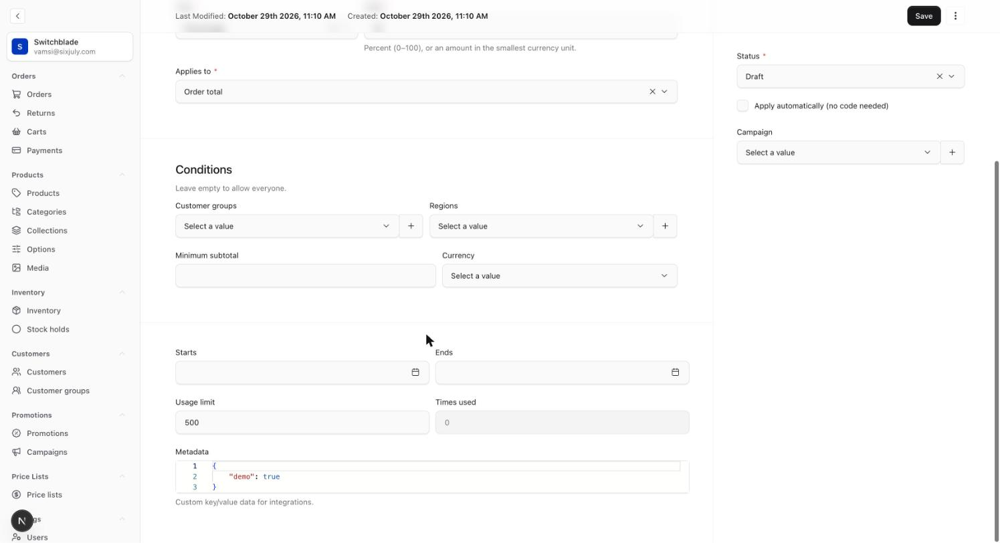

### Step 6.6 Save

Click **Save** (top right). The coupon now shows in the Promotions list and on its campaign's page.

---

## Part 7. Check your work

- [ ] Product status is **Published**
- [ ] **Enable INR price** is ticked and has a price
- [ ] Variants have stock (the list shows "N in stock", not "Out of stock")
- [ ] Thumbnail and Media images are set
- [ ] **Discountable = Yes** if you made a coupon for it
- [ ] Coupon **Status = Active**, dates cover today, and the product is listed under Specific items
- [ ] The product page opens at `/products/<handle>`

Then add the product to the bag on the shop, enter the code in **Coupon code** and click **Apply**. The order summary shows the discount, and Razorpay charges the lower total. After payment, the coupon's **Times used** and the campaign's **Used** go up.

---

## Troubleshooting

| Problem                                  | Fix                                                                                                             |
| ---------------------------------------- | --------------------------------------------------------------------------------------------------------------- |
| Product isn't in the shop                | It's still Draft (click **Publish changes**), **Enable INR price** is off, or it has no handle                  |
| List says "No ₹ price"                   | Tick **Enable INR price** and enter a price                                                                     |
| List says "Out of stock"                 | Add stock in the Variants & stock panel or the Inventory field                                                  |
| Can't add variants                       | Save the product (**Save Draft**) first                                                                         |
| A colour or size is missing              | Add it under **Products → Options** first                                                                       |
| Coupon code is rejected on the bag page  | The message says why: check Status, dates, Usage limit, Minimum subtotal, and the products under Specific items |
| Image thumbnails are broken in the admin | Make sure the latest `src/payload/collections/media.ts` is deployed                                             |
